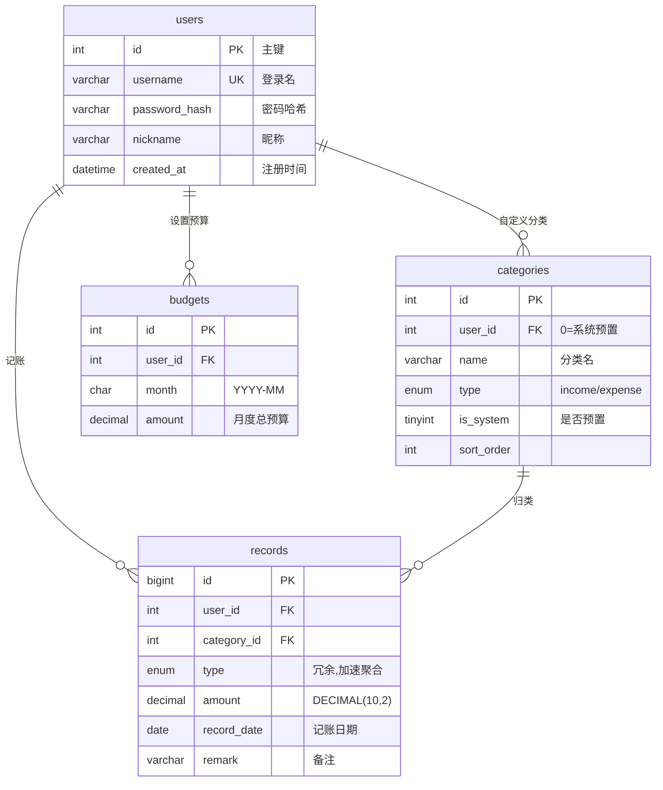

# 数据库设计说明（题目三 · 个人记账本）

> 对应实现：`database/schema.sql`（建库建表 + 预置分类）
> 数据库：MySQL 8.0　字符集：utf8mb4 / utf8mb4_unicode_ci　存储引擎：InnoDB

## 一、实体关系图（ER 图）



关系说明：

- `users 1 ── N records`：一个用户有多条记账记录，删用户级联删记录（`ON DELETE CASCADE`）。
- `users 1 ── N categories`：自定义分类归属用户；系统预置分类用 `user_id = 0` 表示全局模板，不属于任何用户。
- `categories 1 ── N records`：分类删除用 `ON DELETE RESTRICT`，防止误删导致历史记录失去分类。
- `users 1 ── N budgets`，且 `(user_id, month)` 唯一：一个月只有一条预算。

## 二、表结构说明

### 1. users（用户表）

| 字段 | 类型 | 约束 | 说明 |
|---|---|---|---|
| id | INT UNSIGNED | PK, AUTO_INCREMENT | 主键 |
| username | VARCHAR(32) | NOT NULL, UNIQUE | 登录名，唯一索引 `uk_username` |
| password_hash | VARCHAR(255) | NOT NULL | 只存哈希（werkzeug `generate_password_hash`），绝不存明文 |
| nickname | VARCHAR(32) | NULL | 昵称，未填时页面显示 username |
| created_at | DATETIME | DEFAULT CURRENT_TIMESTAMP | 注册时间 |

`password_hash` 给到 255 是因为 werkzeug 的 pbkdf2 哈希串长度约 100+ 字符，按 255 留余量。

### 2. categories（分类表）

| 字段 | 类型 | 约束 | 说明 |
|---|---|---|---|
| id | INT UNSIGNED | PK | 主键 |
| user_id | INT UNSIGNED | NOT NULL | 归属用户；`0` 表示系统预置分类 |
| name | VARCHAR(32) | NOT NULL | 分类名，如“餐饮” |
| type | ENUM('income','expense') | NOT NULL | 该分类属于收入还是支出 |
| is_system | TINYINT(1) | DEFAULT 0 | 1 表示预置分类，不可被用户删除 |
| sort_order | INT | DEFAULT 0 | 下拉框排序用 |

唯一键 `uk_user_name_type (user_id, name, type)`：同一用户不能建两个同名同类型的分类，避免统计时出现“餐饮”和“餐饮 ”两个柱子。

### 3. records（记账条目表，核心表）

| 字段 | 类型 | 约束 | 说明 |
|---|---|---|---|
| id | BIGINT UNSIGNED | PK | 主键（用 BIGINT，记账条目增长快） |
| user_id | INT UNSIGNED | NOT NULL, FK | 所属用户 |
| category_id | INT UNSIGNED | NOT NULL, FK | 分类 |
| type | ENUM('income','expense') | NOT NULL | 冗余字段，见下方“设计取舍” |
| amount | DECIMAL(10,2) | NOT NULL, CHECK ≥ 0 | 金额，10 位总长度、2 位小数，最大 99,999,999.99 |
| record_date | DATE | NOT NULL | 记账日期（不是创建时间，可补记昨天的账） |
| remark | VARCHAR(255) | DEFAULT '' | 备注 |
| created_at / updated_at | DATETIME | 自动维护 | 审计字段 |

索引设计：

- `idx_user_date (user_id, record_date)`：支撑“按月份/日期区间筛选”和“当月每日折线图”。
- `idx_user_type_date (user_id, type, record_date)`：支撑“近 6 个月收支并列柱状图”（按类型 + 日期过滤）。
- `idx_user_category (user_id, category_id)`：支撑“分类占比饼图”与分类筛选。

三个索引都带 `user_id` 前缀，符合“所有查询都先按当前登录用户过滤”的访问模式。

### 4. budgets（月度预算表，加分项）

| 字段 | 类型 | 约束 | 说明 |
|---|---|---|---|
| id | INT UNSIGNED | PK | 主键 |
| user_id | INT UNSIGNED | NOT NULL, FK | 所属用户 |
| month | CHAR(7) | NOT NULL | 形如 `2026-10`，固定 7 位，比存 DATE 更直观 |
| amount | DECIMAL(10,2) | NOT NULL | 该月总预算 |

唯一键 `uk_user_month (user_id, month)`：一人一月一条，设置预算时用 `INSERT ... ON DUPLICATE KEY UPDATE` 即可幂等保存。

## 三、三条统计 SQL（对应三张图表）

题目要求“筛选与统计在服务端完成（SQL 聚合），不允许把全表拉到前端再算”，以下三条就是统计页的数据来源。

### 1. 当月支出分类占比（饼图）

```sql
SELECT c.name AS category, SUM(r.amount) AS total
FROM records r
JOIN categories c ON c.id = r.category_id
WHERE r.user_id = %(uid)s
  AND r.type = 'expense'
  AND r.record_date >= %(start)s
  AND r.record_date <  %(end)s
GROUP BY c.id, c.name
ORDER BY total DESC;
```

### 2. 近 6 个月收支并列对比（柱状图）

```sql
SELECT DATE_FORMAT(r.record_date, '%%Y-%%m') AS ym,
       SUM(CASE WHEN r.type = 'income'  THEN r.amount ELSE 0 END) AS income,
       SUM(CASE WHEN r.type = 'expense' THEN r.amount ELSE 0 END) AS expense
FROM records r
WHERE r.user_id = %(uid)s
  AND r.record_date >= %(start)s
GROUP BY ym
ORDER BY ym;
```

> **缺口处理**：SQL 只会返回“有数据的月份”，某月一条记录都没有就不会出行。不能直接交给 ECharts——那会让 x 轴月份错位（和课程 Debug 示例里 BUG-003 是同一类坑）。做法是在 Python 层用 `calendar` 生成完整 6 个月的坐标轴，把 SQL 结果按 `ym` 塞进对应槽位，空月补 0。

### 3. 当月每日支出（折线图）

```sql
SELECT DAY(r.record_date) AS d, SUM(r.amount) AS total
FROM records r
WHERE r.user_id = %(uid)s
  AND r.type = 'expense'
  AND r.record_date >= %(start)s
  AND r.record_date <  %(end)s
GROUP BY d
ORDER BY d;
```

> **缺口处理**：同理，没有记账的日期要补 `0` 而不是 `null`（折线要连续），x 轴取 `1..当月最后一天`（用 `calendar.monthrange` 得到，不能写死 31）。

### 4. 预算超支判断（加分项）

```sql
SELECT
    (SELECT COALESCE(SUM(amount), 0) FROM records
      WHERE user_id = %(uid)s AND type = 'expense'
        AND record_date >= %(start)s AND record_date < %(end)s) AS spent,
    (SELECT amount FROM budgets WHERE user_id = %(uid)s AND month = %(month)s) AS budget;
```

页面逻辑：`budget` 为空表示没设预算，不提示；`spent / budget >= 0.8` 时顶部出现醒目黄色提醒，`>= 1` 时变红并显示超支金额。

## 四、设计取舍（报告里可直接用这一段）

| 取舍点 | 选择 | 为什么不选另一种 |
|---|---|---|
| 金额类型 | `DECIMAL(10,2)` | `FLOAT/DOUBLE` 是二进制浮点，`0.1+0.2 != 0.3`，累加几百条后统计会出现 `1234.5600000000001` 这种脏数据 |
| 收支类型 | `ENUM` + records 表冗余 | 只用分类表 JOIN 也能拿到 type，但每张图都要多 JOIN 一次；冗余一个 ENUM 字段换来更短的 SQL 和更快的聚合，代价是插入时保证两处一致（由服务层统一写入保证） |
| 分类体系 | 预置行 `user_id=0` + 用户自定义 | 若每个用户都复制一份预置分类，用户多了表会膨胀；用 0 号“模板行”+ 首次登录复制，兼顾灵活与干净 |
| 日期 | `DATE`（不是 DATETIME） | 记账只关心哪一天，不需要时分秒；DATE 让 `GROUP BY record_date` 天然按天聚合，也省掉 `DATE()` 函数包一层导致索引失效 |
| 月份 | `CHAR(7)` | `'2026-10'` 字符串可直接和前端 `month` 输入框对齐，且唯一键简单；用 DATE 存月首日反而要在代码里反复转换 |
| 删除策略 | 用户级联删、分类限制删 | 删用户时数据应一并清理；分类被引用时禁止删除，保护历史数据完整性 |
| 密码 | 只存 werkzeug 哈希 | 明文或 MD5 都属于安全缺陷，报告里可作为“安全性考虑”一条 |

## 五、数据一致性约定

1. 所有写操作校验“`records.user_id` 必须等于当前 session 用户”，防止改 URL 里的 id 越权改别人的账。
2. `records.type` 必须与 `categories.type` 保持一致，由服务层在新增/编辑时按分类反查写入，不信任前端传的 type。
3. 金额在服务端用 `Decimal` 处理（`decimal.Decimal(str(x)).quantize(Decimal('0.01'))`），不用 float 中转。
4. 日期用 `datetime.date.fromisoformat()` 解析，非法格式返回 400 而不是 500。
